# 🚀 Learn DevOps

> The modern, interactive open-source platform for learning Cloud Engineering, DevOps Automation, and Infrastructure as Code.

[](https://nextjs.org/)
[](https://react.dev/)
[](https://www.typescriptlang.org/)
[](https://tailwindcss.com/)
[](LICENSE)
[](https://github.com/chairielazizi/learn-devops-website)

---

## 📖 About The Platform

**Learn DevOps** is an all-in-one learning ecosystem built for software engineers, systems administrators, and aspiring cloud architects. It bridges the gap between passive reading and real-world hands-on engineering by pairing **deep, authentic architectural tutorials** with **interactive in-browser simulated terminals, interactive quizzes, multi-cloud certification roadmaps, and production incident runbooks**.

- 💡 **Zero Setup Required**: Practice Docker commands, Kubernetes manifests, and Terraform workflows directly in simulated browser sandboxes without burning cloud credits.
- 📚 **260+ In-Depth Lessons**: Covering Docker, Kubernetes, Terraform, AWS, GitLab CI/CD, GitHub Actions, Git, and Linux.
- 🎯 **Interactive Knowledge Checks**: Test your comprehension after every tutorial with interactive multiple-choice questions, instant feedback, and remediation explanations.
- 🏆 **18 Multi-Cloud Certification Blueprints**: Comprehensive exam guides and domain checklists for CNCF, HashiCorp, AWS, Microsoft Azure, and Google Cloud Platform (Associate to Professional).
- 🛠️ **DevOps Utility Suite**: Built-in Dockerfile linters, Compose validators, Kubernetes manifest generators, cron parsers, and quick CLI cheatsheets.
- 🚨 **80+ Production Incident Runbooks**: Step-by-step diagnostic workflows for real-world outages (AWS ALB 502s, CrashLoopBackOff, Git merge conflicts, Terraform state drift).

---

## 📸 Platform Modules & Visual Tour

### 1. Interactive Homepage & Simulated Cloud Shell
*Practice real commands right on the landing page with zero installation. Run simulated Docker containers, inspect Kubernetes pods, apply Terraform plans, and review Git status in a browser-based CLI.*

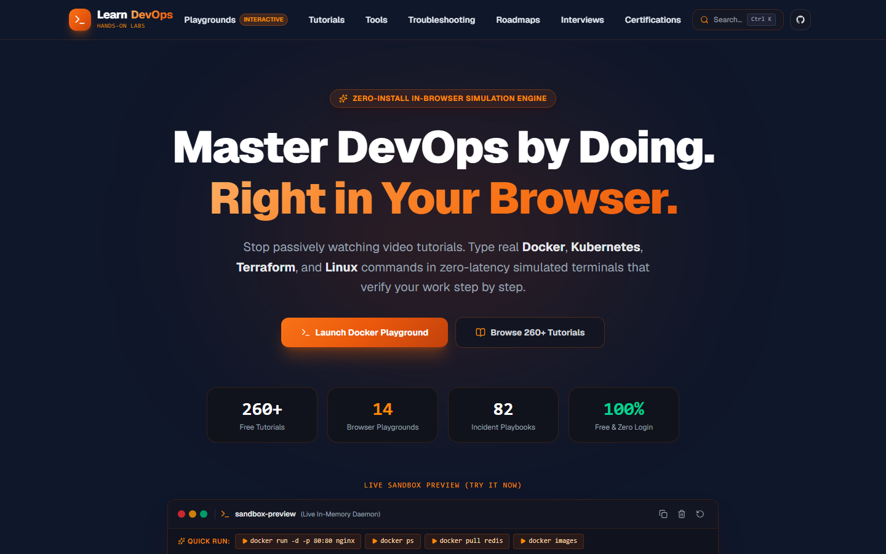

---

### 2. Comprehensive Curriculum & Tutorial Catalog
*Explore 8 structured tracks covering fundamental to advanced infrastructure domains. Filter by technology, difficulty level, and study duration.*

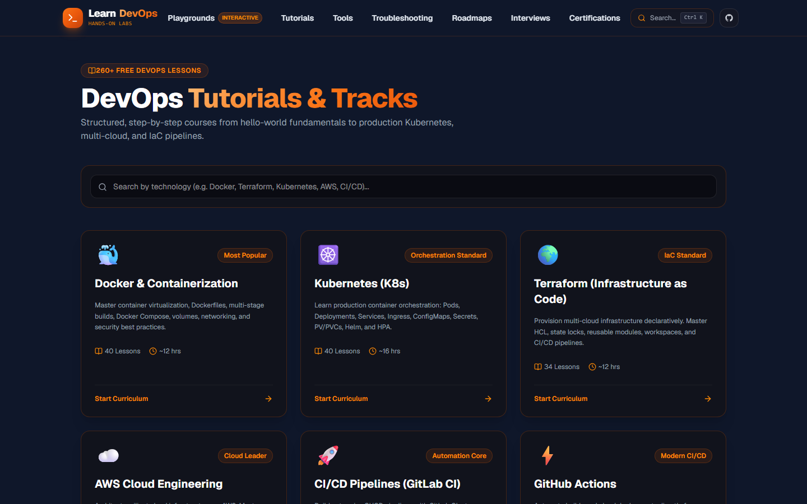

---

### 3. Track Curriculum & Hierarchical Modules
*Every track is organized into cohesive modules where parent topics and their corresponding sub-topics are structured cleanly. Features direct "See Notes" and "Try Lab" quick navigation.*

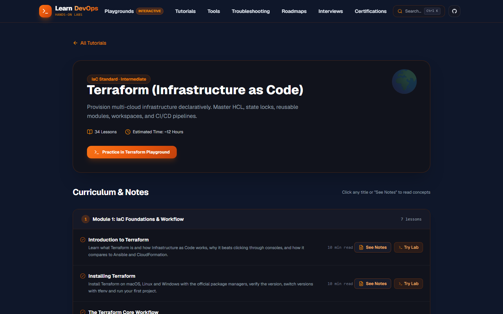

---

### 4. Detailed Lesson Notes & Interactive Knowledge Checks
*Deep-dive concept breakdowns with syntax-highlighted code blocks, copy utilities, and expandable FAQs. Every lesson concludes with interactive Multiple-Choice Questions (MCQs) offering instant verification, attempts tracking, and targeted hints.*

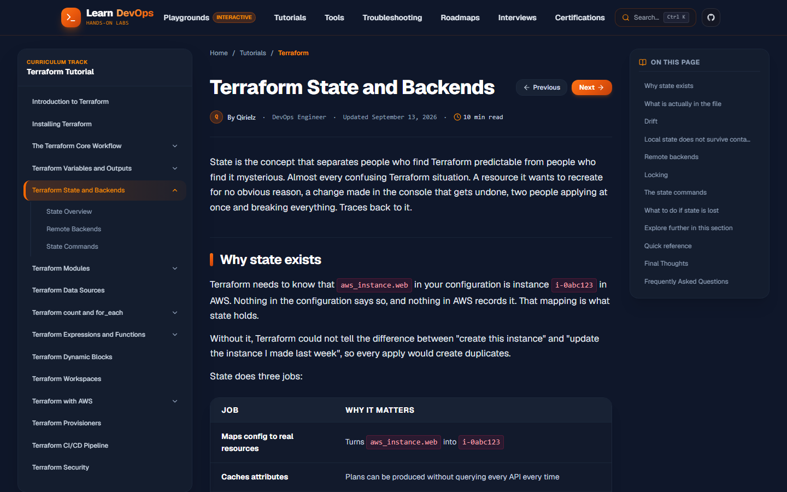

---

### 5. Hands-on Browser Playgrounds Hub
*Launch simulated sandbox environments for Docker, Kubernetes, Linux, and Terraform. Includes dedicated preparation sandboxes for the Certified Kubernetes Administrator (CKA) exam.*

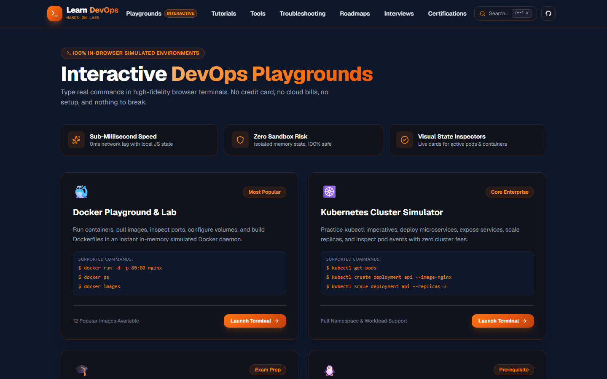

---

### 6. Guided Interactive Lab Environments
*Follow step-by-step guided instructions side-by-side with a responsive in-browser terminal emulator. Run commands, verify outputs, and reset state on demand.*

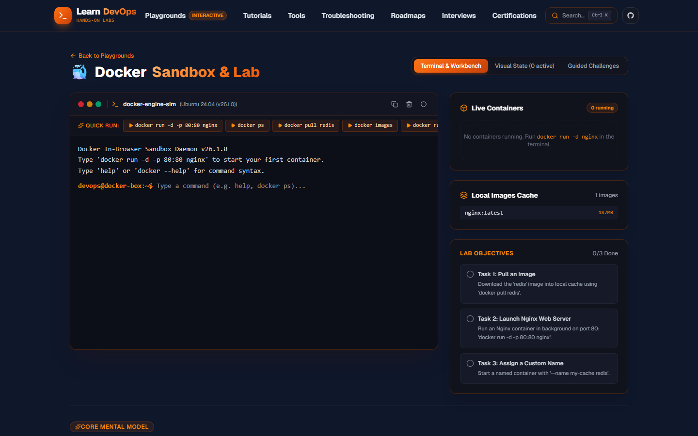

---

### 7. Multi-Cloud Certification Hub
*Prepare for industry-standard certifications grouped by provider: CNCF (Kubernetes), HashiCorp (Terraform), AWS, Microsoft Azure, and Google Cloud Platform (GCP). Includes direct links to official exam portals.*

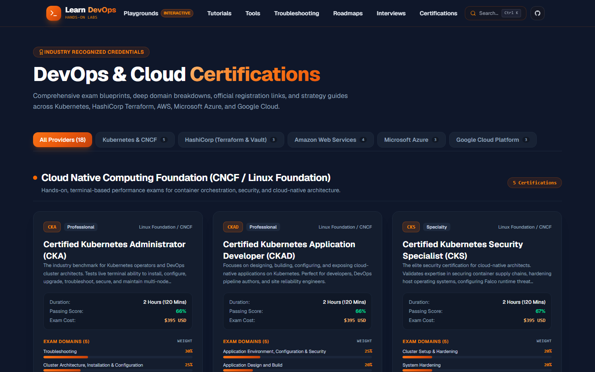

---

### 8. In-Depth Certification Exam Blueprints
*Detailed domain breakdowns, scoring weights, question format analyses, prerequisite requirements, and preparation checklists for exams like CKA, AWS DevOps Pro, and GCP Cloud Engineer.*

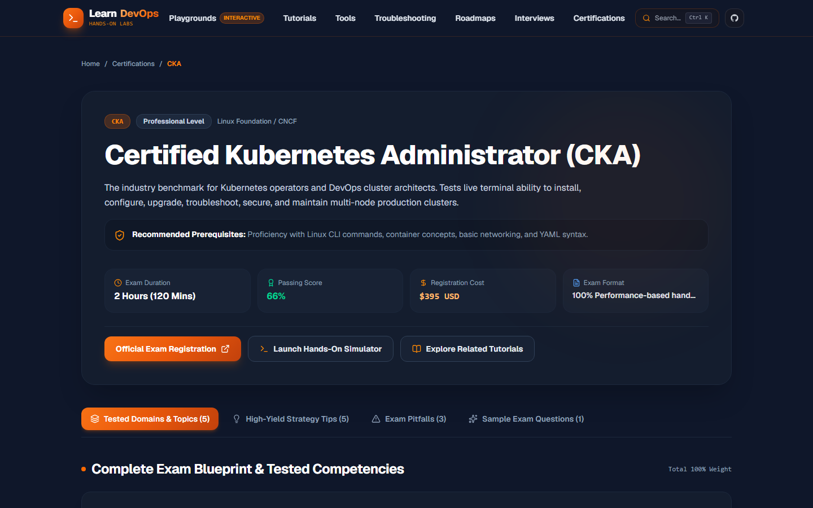

---

### 9. Interactive DevOps Developer Tools & Cheatsheets
*A collection of browser utilities for day-to-day DevOps work: Dockerfile syntax linters, Docker Compose validators, K8s YAML generators, Cron schedule parsers, and quick command cheatsheets.*

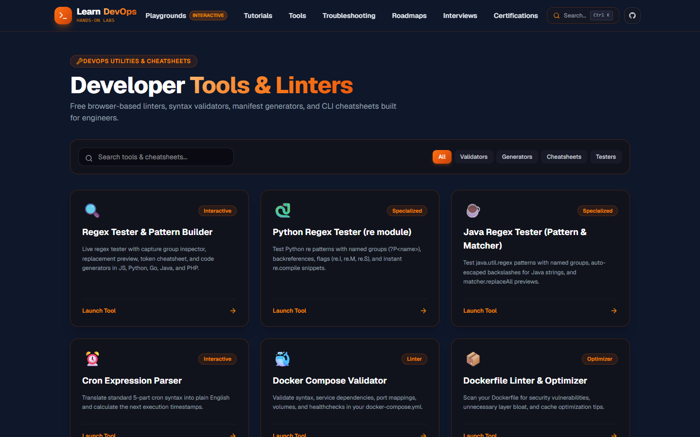

---

### 10. Scenario-Based Interview Preparation
*100+ real-world interview questions and architectural scenarios categorized across containerization, orchestration, IaC, and cloud infrastructure.*

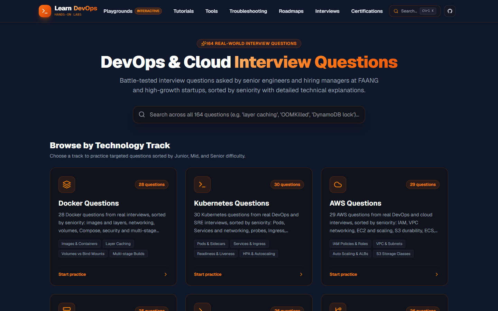

---

### 11. Career Roadmaps for Engineers
*Clear milestone pathways outlining prerequisite skills, recommended tools, and progression milestones for DevOps Engineers, Site Reliability Engineers (SRE), and Cloud Engineers.*

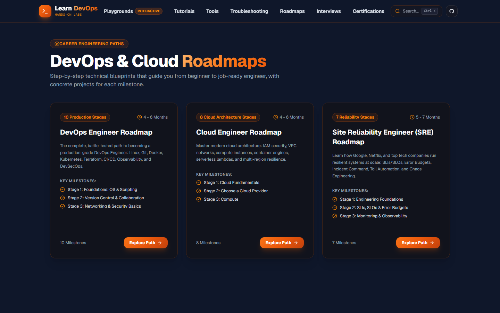

---

### 12. Production Troubleshooting & Incident Runbooks
*80+ battle-tested troubleshooting guides covering real-world cloud failures, network misconfigurations, permission denials, and state corruptions with concrete root cause analyses.*

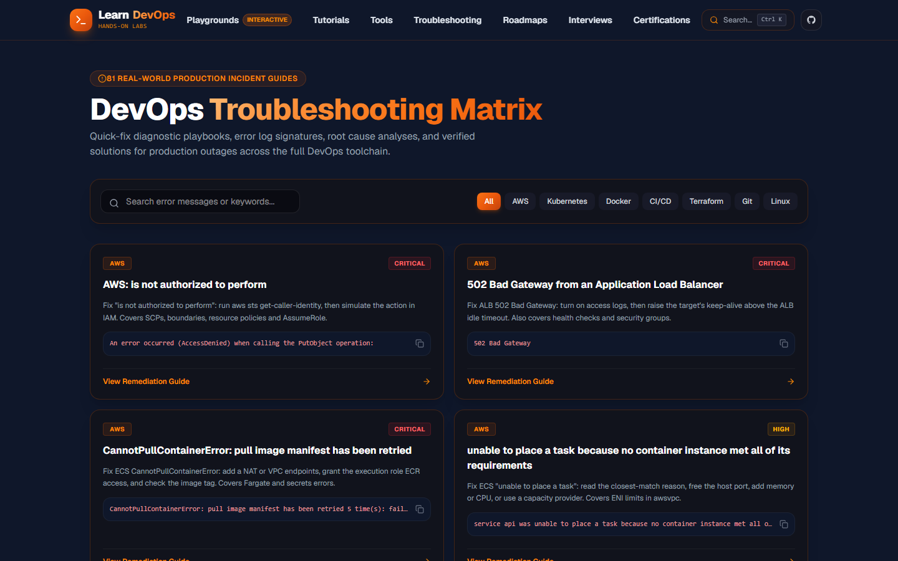

---

## 🛠️ Technology Stack & Architecture

| Component | Technology | Description |
| :--- | :--- | :--- |
| **Framework** | [Next.js 16](https://nextjs.org/) (App Router) | Utilizing Turbopack, Partial Prerendering (PPR), and static generation across 430+ routes |
| **Frontend Runtime** | [React 19](https://react.dev/) | Modern concurrent React features and client-side state hooks |
| **Language** | [TypeScript 5](https://www.typescriptlang.org/) | Strictly typed schemas for lessons, modules, and diagnostic guides |
| **Styling** | [Tailwind CSS v4](https://tailwindcss.com/) | Custom Dark Slate theme (`#0f172a`) with vibrant Orange Gradient accents |
| **Icons** | [Lucide React](https://lucide.dev/) | Consistent iconography throughout the platform |
| **Markdown Engine** | `react-markdown` + `remark-gfm` | Custom component rendering for code copy, inline badges, and interactive MCQs |
| **Terminal Simulation** | Custom Client-Side State Engine | In-memory simulated shell supporting commands for Docker, Kubernetes, Linux, Git, and Terraform |

---

## ⚡ Getting Started Locally

### Prerequisites
- [Node.js](https://nodejs.org/) (v20.x or higher recommended)
- `npm` or `pnpm`

### Installation

1. **Clone the repository:**
   ```bash
   git clone https://github.com/chairielazizi/learn-devops-website.git
   cd learn-devops-website
   ```

2. **Install project dependencies:**
   ```bash
   npm install
   ```

3. **Start the development server:**
   ```bash
   npm run dev
   ```

4. **Open in your browser:**
   Navigate to [http://localhost:3000](http://localhost:3000) to view the application.

### Building for Production

To build and verify the static generation of all 431+ routes:

```bash
npm run build
npm run start
```

---

## 📂 Project Structure

```text
learn-devops/
├── public/
│   ├── favicon.svg              # Platform icon
│   └── screenshots/              # High-resolution screenshots of all modules
├── src/
│   ├── app/                     # Next.js App Router routes
│   │   ├── certifications/      # Multi-cloud certification blueprint routes
│   │   ├── interview-questions/ # Technical interview preparation routes
│   │   ├── playground/          # Interactive browser terminals & labs
│   │   ├── roadmaps/            # Career progression roadmaps
│   │   ├── tools/               # DevOps developer tools & cheatsheets
│   │   ├── troubleshooting/     # Production incident diagnostic runbooks
│   │   ├── tutorials/           # Curriculum tracks & lesson detail notes
│   │   ├── layout.tsx           # Root application shell & metadata
│   │   └── page.tsx             # Homepage & interactive hero terminal
│   ├── components/              # Modular UI components
│   │   ├── common/              # Navbar, Footer, Command Palette (Ctrl+K)
│   │   ├── terminal/            # InteractiveTerminal simulator component
│   │   └── tutorials/           # MarkdownLessonRenderer, MCQExerciseCard
│   ├── data/                    # Curriculum data, blueprints, & troubleshooting runbooks
│   │   ├── lessons/             # Track lesson content JSONs (Docker, K8s, Terraform, AWS...)
│   │   ├── certificationsData.ts# 18 multi-cloud certification exam blueprints
│   │   ├── toolsData.ts         # Utility tools & cheatsheet definitions
│   │   └── tutorialsData.ts     # Canonical curriculum module definitions
│   └── lib/                     # In-memory terminal execution engines
└── package.json
```

---

## 👤 Author & Credits

- **Author**: [Qirielz](https://github.com/chairielazizi)
- **Repository**: [chairielazizi/learn-devops-website](https://github.com/chairielazizi/learn-devops-website)
- Inspired by real-world production engineering practices and open-source DevOps communities.

---

## 📄 License

This project is open-source and available under the [MIT License](LICENSE).
